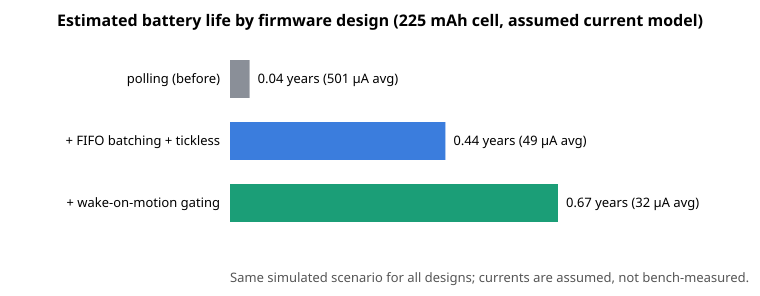

# Microamp — battery-sensor firmware with power budgeting and on-device ML event detection

RTOS firmware for a simulated battery-powered motion sensor. It samples an I2C accelerometer, detects
**harsh braking** and **impacts** with a tiny int8 neural network running in fixed-point C, reports events as
nanopb protobuf, and tells you the **estimated battery life in years** for three firmware designs.



> **Read this first — the currents are assumed, not measured.** Every battery-life figure comes from a
> per-state current model (`energy_default_params` in `firmware/power/energy.c`: illustrative
> STM32L4-class MCU, BLE radio burst and LIS3DH-class sensor values). Nothing was bench-measured on
> hardware, and cycle counts are modelled, not taken from a target. The *relative* gains between designs
> are meaningful; the absolute years are only as good as the assumptions.

| design change | avg current | est. battery life | events found (recall / precision) |
|---|---|---|---|
| `polling` — 100 Hz timer task, 1 kHz tick (before) | 501 µA | 0.04 years | 1.00 / 1.00 |
| `fifo` — sensor FIFO batching + tickless sleep | 49 µA | 0.44 years | 1.00 / 1.00 |
| `wom` — + wake-on-motion / inference gating | 32 µA | 0.67 years | 1.00 / 1.00 |

Simulated `day` scenario, 600 s, seed 7, 225 mAh cell, 11 ground-truth events (`make chart` / `make compare`).
Average current falls by **94 %** from `polling` to `wom` (≈17× longer life).

## On-device model: footprint vs accuracy

| metric | value |
|---|---|
| Architecture | 64-sample window → 16 integer features → MLP 16→24→12→3 (int8) |
| Flash (model) | 932 B (708 B weights, 156 B biases, 68 B multipliers) |
| RAM | 64 B inference scratch + 420 B detector window, static, no heap |
| Compute | 708 MACs; ≈18.1k cycles/window (modelled Cortex-M4) = 1.13 ms @ 16 MHz, 0.35 % CPU duty |
| Accuracy (held-out, int8) | 99.9 % on 22.5k synthetic windows — same as float |

Accuracy is measured on synthetic data from the same generator as the simulator, so it demonstrates the
pipeline, not real-world performance. Regenerate the numbers with `make report`.

## Demo (one command)

```bash
make deps && make demo
```
`make demo` replays a synthetic 240 s drive through the firmware, prints the ground-truth events, the events
decoded from the nanopb log, and the projected battery life (e.g. 7/7 events found, 0.44 years for the
`wom` design in that run's `drive` scenario, where the sensor is almost never quiet).

## Features

- **Simulated I2C accelerometer** (`sim/microamp_sim/`): a LIS3DH-style register map (CTRL_REG1-5, STATUS,
  OUT_X..Z, FIFO_CTRL/FIFO_SRC, INT1_CFG/SRC/THS), a 32-deep FIFO (bypass / FIFO / stream modes with
  watermark and full flags), a latched high-pass motion interrupt and an INT pin that is routed by CTRL_REG3.
  Motion comes from a seeded synthetic generator (parked, driving, speed bumps, harsh braking, impacts) with
  ground-truth labels.
- **Portable driver** (`firmware/drivers/accel_driver.c`) written only against `firmware/hal/hal.h`
  (I2C transfer, IRQ line, time, sleep, radio). `hal_posix_sim.c` is the simulator backend; a real MCU port
  re-implements ~6 functions.
- **FreeRTOS tasks** (POSIX simulator port, statically allocated — no kernel heap):
  `sampler` (owns the sensor), `detector` (windowing + ML), `reporter` (nanopb + heartbeat). They communicate
  through queues, a binary IRQ semaphore and a bus mutex. Idle is **tickless**: the sampler sleeps on the sensor
  interrupt and the idle hook fast-forwards virtual time to the next interrupt or RTOS timeout.
- **int8 classifier** (`ml/`, `firmware/ml/`): 64-sample window → 16 integer features → MLP 16→24→12→3
  (normal / harsh_brake / impact). Trained in NumPy, post-training-quantised, exported as C arrays. Runtime is
  integer-only with static scratch — no heap, no float.
- **Energy model** (`firmware/power/energy.c`): per-state current (sleep, idle, wake, sample, inference,
  radio) + accelerometer current by ODR → average draw → battery life in years, also sent in the periodic
  `Status` record.
- **nanopb log** (`proto/microamp.proto`): events and status heartbeats are length-delimited `LogRecord`s;
  `tools/decode_log.py` decodes them.

## Architecture

```
 Python process (sim/microamp_sim)                 C process (FreeRTOS POSIX port)
┌────────────────────────────────┐   pipes   ┌─────────────────────────────────────────────────────────┐
│ scenario trace (g, 400 Hz)     │  T/W/P    │ hal_posix_sim.c ──► accel_driver.c ──► sampler task     │
│   └► Accel: regs, ODR, FIFO,   │◄─────────►│        ▲ IRQ edge (semaphore)            │ batch queue  │
│      HP-filter motion, INT pin │ virtual   │ tickless idle hook                       ▼              │
└────────────────────────────────┘ time      │                                  detector task          │
                                             │          features.c → nn_int8.c → event state machine   │
  tools/decode_log.py ◄── microamp.log ◄──── │  reporter task ◄── event queue; nanopb; hal_radio_send  │
  tools/compare_designs.py                   │  energy.c ledger (all tasks + idle hook)                │
                                             └─────────────────────────────────────────────────────────┘
```

Wire protocol (`sim/microamp_sim/server.py`): `T` I2C transaction, `W` wait-for-interrupt-or-timeout
(used for tickless sleep), `P` read INT pin. Every request carries the firmware's virtual time (= RTOS tick
count), so the simulator is deterministic and runs far faster than real time.

### The three firmware designs (`firmware/app/design.c`)

| design | how it works | what it costs |
|---|---|---|
| `polling` | 100 Hz periodic task reads one sample per tick (2 I2C transfers), 1 kHz tick always running | CPU never sleeps deeply |
| `fifo` | sensor FIFO batches 16 samples; MCU stop-sleeps until the watermark interrupt, then drains | sensor still at 100 Hz, ML runs continuously |
| `wom` | like `fifo`, but when the detector sees no motion for 3 s the INT pin is re-routed to the sensor's motion detector; the FIFO (stream mode) keeps 0.32 s of pre-roll that is drained on wake | wake latency; pre-roll is the only history |

## Setup

Requirements: Linux, gcc, git, python3 (3.10+), network once (to fetch pinned FreeRTOS-Kernel V11.1.0,
nanopb 0.4.9.1, Unity v2.6.0 into `third_party/` and Python packages into `.venv/`). CMake is installed into the venv.

```bash
make deps      # scripts/bootstrap.sh
make build
```

No secrets or services are needed. Optional configuration lives in environment variables
(`.env.example`: design, scenario, seed, duration, log path, battery capacity); all have defaults.

## Run

```bash
make demo       # replay a synthetic drive, print events + projected battery life
make run        # 10 simulated minutes with the 'wom' design, then decode the log
make compare    # all three designs on the same scenario: battery years + detection recall/precision
make report     # int8 model size and cycle report
```

Or call the binary directly:
`build/microamp --design fifo --scenario drive --seed 3 --duration 120 --log out/a.log --report out/a.json --python .venv/bin/python`
(`--help` lists every flag). `python tools/decode_log.py out/a.log [--json]` decodes the log;
`report.json` holds the per-state time/charge breakdown.

### Model size and cycle report (`make report`) — details

```
architecture        : 16 -> 24 -> 12 -> 3
flash total (model) : 932 bytes   (708 int8 weights, 156 B int32 biases, 68 B multipliers)
RAM scratch (infer) : 48 bytes activations + 16 bytes input;  detector window 420 bytes (static)
MACs / inference    : 708
cycles / window     : ~16000 features + ~2124 network = ~18124 (Cortex-M4 estimate)
                      => 1.13 ms @ 16 MHz per 320 ms stride = 0.35 % CPU duty
```
Object code (host x86-64 `size`): features 3.0 KB, nn 2.6 KB, detector 1.5 KB. Held-out accuracy of the int8
model is 99.9 % on 22.5k synthetic windows (`docs/model_metrics.json`, same as float).
Cycle numbers are *estimates* from a MAC/sample cost model (host binary, no ARM toolchain required);
host wall time is also printed.

## Test

```bash
make test       # 6 Unity C suites (ctest) + 48 pytest tests
```

- C (Unity): driver against a fake LIS3DH behind the HAL, energy ledger arithmetic, feature extraction and
  network **bit-exact against NumPy golden vectors** (`tests/c/golden_vectors.h`, generated by `ml/train.py`),
  detector state machine, nanopb round-trips.
- Python: simulator register/FIFO/interrupt semantics, wire protocol, scenario generator, quantisation,
  log decoder (hand-encoded protobuf bytes), event matching, and **end-to-end** runs of the real firmware
  binary for all three designs (status records, detections vs ground truth, energy ordering, tickless sleep).

## Key design decisions

- **Simulated time is slaved to the RTOS tick.** FreeRTOS keeps counting ticks, and the tickless idle hook
  (`portSUPPRESS_TICKS_AND_SLEEP`, `configUSE_TICKLESS_IDLE=2`) asks the simulator to fast-forward to the next
  sensor interrupt or timeout. This is the real tickless pattern, and it makes hours of sensor time cheap.
  The POSIX port still has a real 1 ms timer, so runs are deterministic only to a few ticks.
- **Energy is accounted analytically, not by sampling.** Tasks charge busy time per state (I2C bytes at 400 kHz,
  inference cycles at 16 MHz, radio airtime); time not billed as busy is sleep (tickless designs) or idle-WFI
  (`polling`, which also pays a tick ISR every ms). The ledger therefore does not depend on host speed.
  Per-state currents are illustrative values in the range of an STM32L4-class MCU, a BLE radio burst and a
  LIS3DH-class sensor (see `energy_default_params`); change them and re-run. Sample state assumes I2C
  runs with DMA (CPU in WFI) at 0.9 mA. Battery: 225 mAh, 85 % usable, 1 %/year self-discharge.
- **Driver/HAL split.** The driver never touches the simulator; unit tests link it against a fake device.
- **Fixed-point everywhere on the device.** Features use integer math and an exact integer square root; the
  Python feature code mirrors it bit for bit so training sees exactly what the MCU computes. Requantisation is
  `(acc*M + 2^23) >> 24` with int64 intermediates.
- **Gravity-relative features.** The detector tracks a slow baseline (updated only on quiet normal windows),
  so mounting orientation does not matter. Event post-processing merges consecutive abnormal windows into one
  event and applies a plausibility gate: an "impact" with peak < 2 g is demoted (this fixed a real
  misclassification seen with partial windows after a wake-from-sleep gap in the `wom` design).
- **No heap.** FreeRTOS is built with `configSUPPORT_DYNAMIC_ALLOCATION 0`; queues, tasks, semaphores and
  buffers are static. nanopb encodes into a stack buffer sized by the generated `LogRecord_size`.
- **Generated code is committed** (`firmware/proto/*.pb.*`, `firmware/model/model_data.*`,
  `tests/c/golden_vectors.h`) so a build needs no generator; `make train` / `make proto` regenerate them.
  The protobuf decoder in `tools/decode_log.py` is a small hand-written wire-format reader, so no protobuf
  runtime is needed to read logs.
- **Training data is synthetic** and shares its generator with the simulator, so the 99.9 % number measures
  how separable *the simulated* classes are, not real-world accuracy. Treat it as a pipeline demonstration.

## Limitations / next steps

- The sensor at 100 Hz dominates the `wom` budget (60-85 %); dropping ODR while quiet would be the next win.
- FIFO is drained with one 6-byte transfer per sample (matching the real part's pop-on-read behaviour); a
  burst read would cut I2C overhead.
- Cycle counts are modelled, not measured on target hardware.
- Single-threaded simulator link: one outstanding I2C transaction, guarded by the bus mutex.

## Layout

```
firmware/{app,drivers,hal,ml,model,power,proto}   C sources     ml/  training + export (NumPy)
sim/microamp_sim/                                 register-level simulator (Python)
tools/  decode_log.py compare_designs.py ml_bench.c               proto/ schema
tests/{c,py}/  scripts/  docs/model_metrics.json  Makefile  CMakeLists.txt
```

## Résumé line

> Wrote RTOS firmware with an int8 on-device event classifier in C; cut projected average current (and so
> projected battery-life cost) by 94 % through power-state redesign (FIFO batching, tickless sleep,
> wake-on-motion gating) — *estimated from an assumed current model, not bench measurements*.
